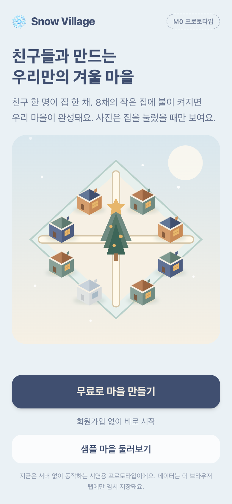
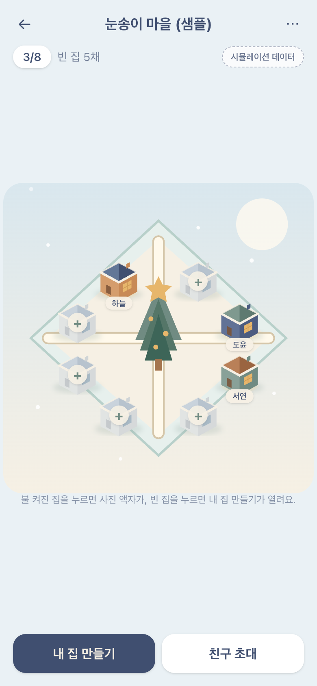
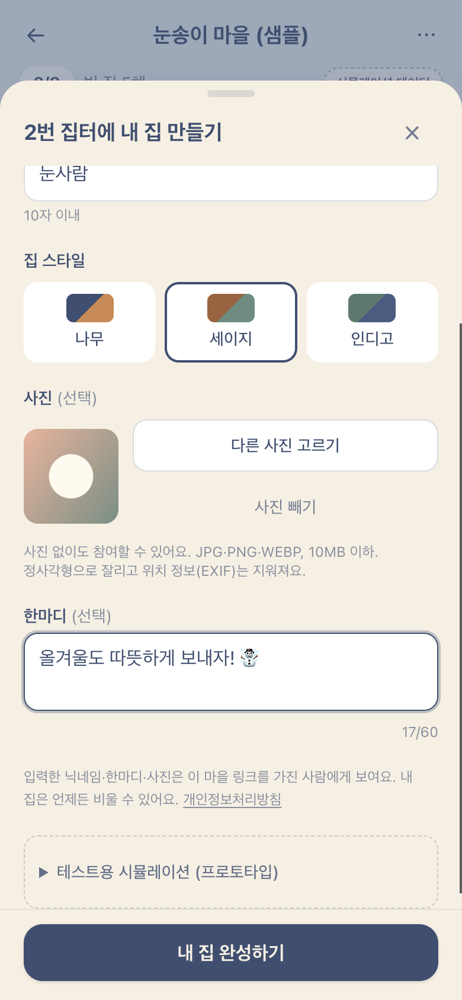
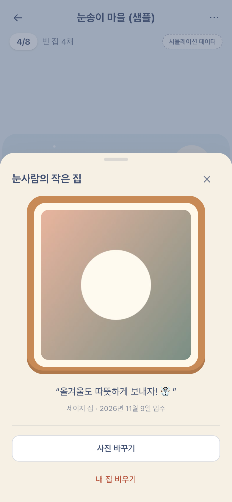
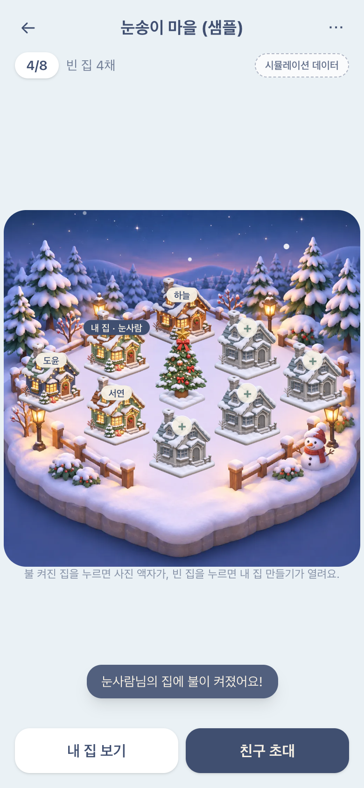
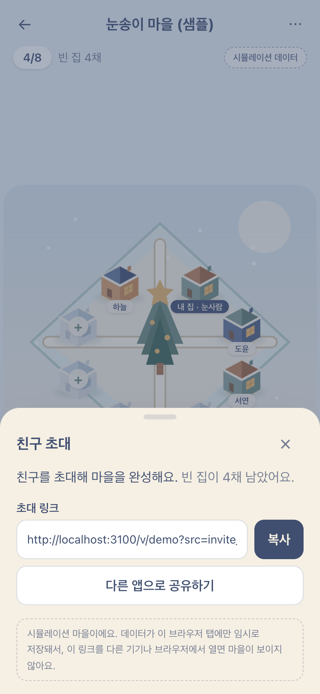
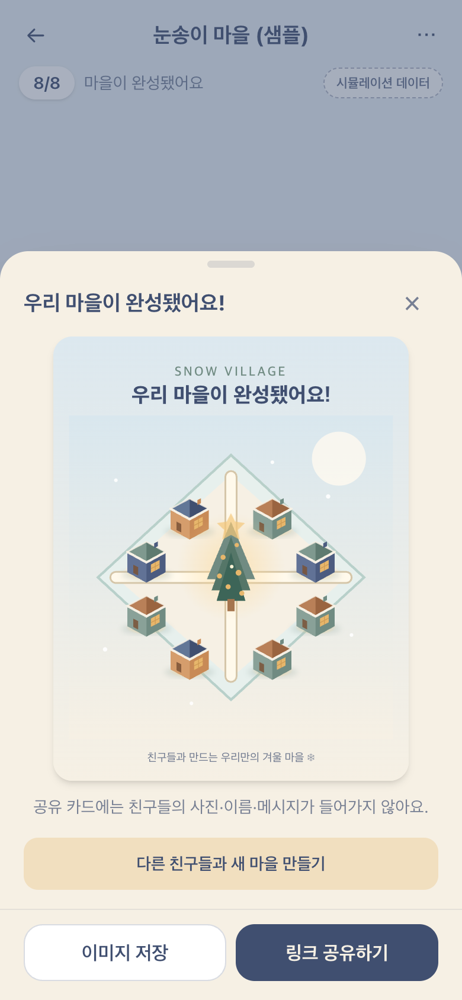
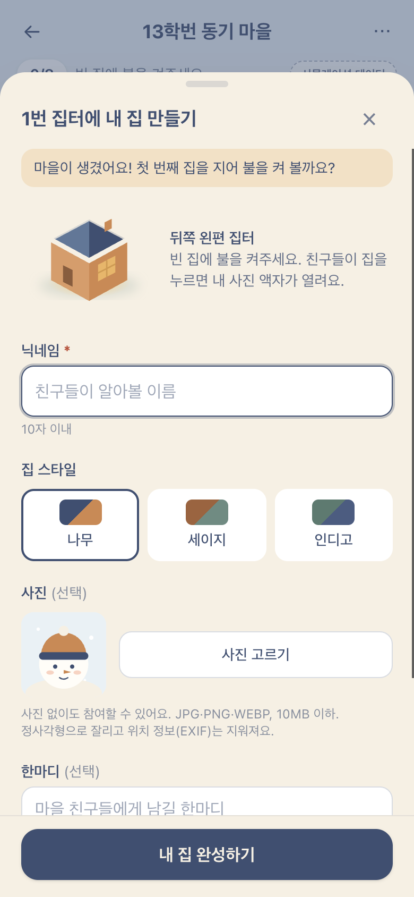

# Snow Village ❄️

**친구들의 작은 순간이 모여 하나의 겨울 마을이 됩니다.**

2026 Christmas mobile-web MVP. Friends join an isometric 2D winter village, decorate one of eight cottages and optionally attach one photo. Photos are displayed in a private frame when the cottage is tapped—not on public sharing previews.

> **Status (2026-11-09):** M0 prototype + **M1 backend** implemented. With `NEXT_PUBLIC_SUPABASE_*` set, villages, houses and private photos live on the shared `mkideabox-games` Supabase project (prefix `snowvill_`) and invite links work across devices. Without it, the app runs in **simulation mode** (data only in the current tab, clearly labelled). The `/v/demo` sample village is always simulated. Not yet done: hosting/domain, privacy policy, owner recovery on a new device, analytics. All market and performance numbers in documents are hypotheses, not verified forecasts.

## Run the M0 prototype

Requirements: Node.js 20.9+ (tested with Node 26 / npm 11).

```bash
npm install
npm run dev          # http://localhost:3000
```

| Command | What it does |
|---|---|
| `npm run dev` | Dev server (Turbopack) |
| `npm run build` | Static export to `out/` (all routes are static; data is fetched in the browser) |
| `npm run preview:cf` | Build + serve `out/` on the local Cloudflare runtime at http://127.0.0.1:3100 (same headers as production) |
| `npm run deploy` | Build + deploy to Cloudflare Workers static assets (needs `npx wrangler login` once) |
| `npm run lint` | ESLint (next core-web-vitals + TypeScript) |
| `npm run typecheck` | `tsc --noEmit` |
| `npm test` | Vitest unit + component tests (jsdom) |
| `npm run screenshots` | Simulation-mode browser smoke test + README screenshots via installed Chrome over CDP (see below) |
| `supabase/tests/local.sh` | SQL tests (58) on a throwaway local Postgres with Supabase's roles/default privileges |
| `supabase/deploy.sh` | Deploy schema + photo bucket + Edge Function via Management API, verify other games unchanged, run live tests |
| `supabase/tests/live.sh` | Live server tests (51) through the anon REST/Edge path; deletes its test data |
| `scripts/e2e-remote.sh` | Multi-device browser E2E against the live backend (needs a build with `.env.local`); verifies server cleanup |

Without `.env.local` the app runs in simulation mode and needs no credentials. To use the real backend, copy `.env.example` to `.env.local` and fill in the **anon** key (public by design — never a service_role/secret key):

```bash
TOK=$(security find-generic-password -a mkideabox-games-mgmt-token -s supabase -w)
curl -s -H "Authorization: Bearer $TOK" "https://api.supabase.com/v1/projects/qfhbkfzxhldfycmcwntw/api-keys?reveal=true" \
  | python3 -c "import json,sys;print(next(k['api_key'] for k in json.load(sys.stdin) if k['name']=='anon'))"
```

### Try it
- `/` landing → **무료로 마을 만들기** → `/create` → name the village → `/v/?id=<id>` opens the first-house sheet.
- `/v/?id=demo` is a **sample village** (3/8 occupied, fallback illustrations). `⋯` menu → *샘플 마을 초기화* restores it.
- Tap an empty house (`+`) → claim sheet (nickname, 3 styles, optional photo, ≤60-char message).
- Tap a lit house → photo-frame sheet (photo or fallback illustration, message, date, report, remove).
- **친구 초대** → copy link / Web Share. `⋯` → *친구 입주 시뮬레이션* fills empty slots with fictional friends; at 8/8 the completion share sheet opens with a **photo-free** 1080×1350 card (PNG download).
- In the claim sheet, *테스트용 시뮬레이션* can force a **slot collision** or a **failed upload** to demo those states.

### Browser smoke test / screenshots

Uses the installed Google Chrome (not a bundled Chromium) through loopback CDP:

```bash
npm run build && npx next start -p 3100 &
open -na "Google Chrome" --args --user-data-dir="$(mktemp -d)" \
  --remote-debugging-address=127.0.0.1 --remote-debugging-port=9222 --headless=new about:blank
CDP_URL=http://127.0.0.1:9222 BASE_URL=http://localhost:3100 npm run screenshots
```

It walks the full flow (sample → claim with a generated test image → frame → invite → fill → share card export → create), asserts 8 hotspots ≥44px, no horizontal overflow at 320/390/480px, reduced-motion behaviour and zero console errors, and writes PNGs to `docs/screenshots/`.

## Hosting

**Deployed (beta, 2026-11-09):** https://snow-village.myappmanage.workers.dev — Cloudflare account `Rumururu@gmail.com's Account`, Worker `snow-village`. Custom domain not attached yet.

The site is a **static export** (`output: "export"`) served by **Cloudflare Workers static assets** (`wrangler.jsonc`, no Worker script) — free and not metered per request. Village pages are `/v/?id=<id>` because static exports cannot serve arbitrary dynamic path segments. `public/_headers` sets the CSP (only this site + the Supabase project), `nosniff`, referrer/permissions policies, `noindex`, and immutable caching for hashed assets.

Deploy checklist:
1. `npx wrangler login` (Cloudflare account that owns `mkideabox.com`).
2. Make sure `.env.local` exists (otherwise the deployed site runs in simulation mode), then `npm run deploy`.
3. Add the production origin to the Edge Function CORS list: Supabase secret `SNOWVILL_ALLOWED_ORIGINS` (comma-separated, keep the localhost entries), then `supabase/deploy.sh`.
4. Run `scripts/e2e-remote.sh` with `BASE_URL=<production origin>`.

## Backend (M1)

Shared Supabase project **`mkideabox-games`** (ref `qfhbkfzxhldfycmcwntw`, Seoul), governed by
`/Volumes/home_extension/mkideabox-corp-process/processes/infrastructure/game-shared-backend.md`: every object is prefixed `snowvill_`, deploys go through the Management API with the keychain token (never `supabase login`), and other games' objects must not change.

| Piece | What it does |
|---|---|
| `supabase/migrations/…_snowvill_core.sql` | Tables `snowvill_villages/houses/reports/calls` (RLS on, no policies, all grants revoked). Anon functions: `snowvill_create_village`, `snowvill_get_village`, `snowvill_claim_house` (village row lock + `UNIQUE(village_id, slot)`), `snowvill_report`. Validation → 400, per-install rate limits → 429 |
| `supabase/migrations/…_snowvill_photo_bucket.sql` | Private bucket `snowvill-photos` (JPEG only, ≤300KB), no storage policies |
| `supabase/functions/snowvill-photo` | Edge Function: upload (claim secret only, JPEG ≤1024px, EXIF/COM segments stripped), 2-minute signed URL for viewing, remove house, delete village (photos deleted too) |

Ownership without accounts: creating a village or claiming a house returns a random secret once; the server stores only its SHA-256, the browser keeps it in `localStorage`. Clearing site data loses owner rights (recovery is still an open decision).

⚠️ The free-plan egress (5GB/month) and DB (500MB) are shared with every game in the organization, including ctw's paid wallet. Photos are the main egress driver, so the beta runs here and **must be re-decided before public launch** (Pro plan or moving photos) — see docs/09-decisions.md.

## Screenshots (390×844, generated by `npm run screenshots`)

| Landing | Village (3/8 sample) | Claim sheet | Photo frame |
|---|---|---|---|
|  |  |  |  |

| House lit | Invite | Completed + share card | Create → first house |
|---|---|---|---|
|  |  |  |  |

Live backend (from `scripts/e2e-remote.sh`): a friend's phone opening the invite link and viewing the creator's photo via signed URL — [11-remote-friend-photo.png](docs/screenshots/11-remote-friend-photo.png); a real server-side slot collision with the draft kept — [12-remote-collision.png](docs/screenshots/12-remote-collision.png).

320px layout: [10-village-320.png](docs/screenshots/10-village-320.png) · exported card: [share-card-export.png](docs/screenshots/share-card-export.png). The "photo" in screenshots is a generated gradient test image, not a real person's photo.

## Code map

```
src/
  app/                     routes: / (S01), /create (S02), /v/?id= (S03 + sheets), not-found, error — static export
  lib/village.ts           pure domain rules: validation, 8-slot cap, atomic-style claim, sample data
  lib/scene.ts             fixed 2:1 isometric slot geometry (from the SVG mockup), depth order, hit boxes
  lib/assets.ts            asset manifest (placeholder → production sprite paths) + palette
  lib/image.ts             photo signature check, 10MB limit, 1:1 crop + canvas re-encode (drops EXIF)
  lib/share.ts             photo-free share-card data, invite URL (non-PII src token), Web Share/copy
  lib/remote.ts            Supabase REST/Edge Function client, error mapping (anon key only)
  store/                   store: remote villages via lib/remote, simulated ones in memory + sessionStorage
  components/scene/        SceneArt (inline SVG placeholders), VillageScene (8 accessible HTML hotspots)
  components/house/        ClaimHouseSheet (S04), PhotoFrameSheet (S05), fallback avatar
  components/share/        InviteSheet, ShareSheet (S06), ShareCard (1080×1350, no photos by type)
  components/ui/           BottomSheet (focus trap/return, Esc, inert background), SimulatedBadge
scripts/screenshots.mjs    Chrome-CDP smoke test + screenshots (simulation mode)
scripts/e2e-remote.*       multi-device E2E against the live backend
supabase/                  migrations, Edge Function, deploy + local/live tests
```

With the backend configured, persistence, cross-device invites, atomic slot claims, private photos, reports, owner removal/deletion and rate limits are **real**. Still simulated or missing: the `/v/demo` sample, owner recovery on another device, analytics events, OG image, hosting. See [docs/06-codex-handoff.md](docs/06-codex-handoff.md#m1-implementation-status).

## Start here (Codex)
1. Read [AGENTS.md](AGENTS.md) and [docs/06-codex-handoff.md](docs/06-codex-handoff.md).
2. Read [product requirements](docs/02-prd.md), [UI spec](docs/03-ui-ux.md), [architecture](docs/04-technical-design.md), and [asset manifest](assets/README.md).
3. Inspect the vector mockup in [assets/mockups/village-concept.svg](assets/mockups/village-concept.svg). It is an **original illustrative placeholder**, not final game art.
4. M0 and the M1 backend are done; next are hosting, privacy policy and the 30–50-group beta (M2).

## Documentation
- [Business plan](docs/01-business-plan.md)
- [PRD and user flows](docs/02-prd.md)
- [Mobile UI/UX details](docs/03-ui-ux.md)
- [Technical architecture and security](docs/04-technical-design.md)
- [Asset brief and prompts](docs/05-art-direction.md)
- [Codex handoff / build order](docs/06-codex-handoff.md)
- [Market positioning and assumptions](docs/07-market-research.md)
- [QA and acceptance criteria](docs/08-qa-analytics.md)
- [Decisions and open issues](docs/09-decisions.md)

**MVP:** browser-first, one cozy winter theme, 8 fixed isometric house slots, 3 house styles, house → photo-frame bottom sheet, privacy-first upload, invitation URL, photo-free share card. No accounts required to join; owner recovery must be addressed before public launch.

**Visual language:** 2:1 isometric projection, ivory snow, wood, sage, indigo, orange light; 2–3 tone cel shading; no heavy black outline.

**Initial milestone:** Nov 2026 design handoff → clickable web prototype → user test → backend → private beta → target Dec 1 launch, subject to QA.

No real user photos, secrets, service-role keys, or licensed third-party artwork may be committed.
